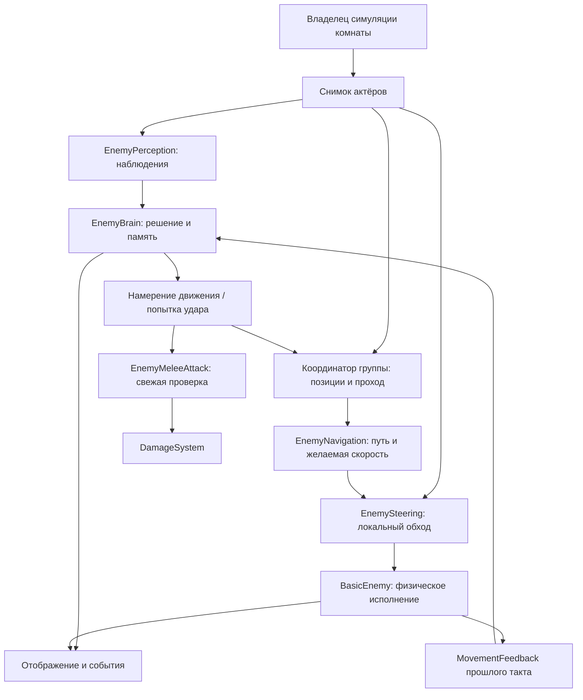

# Целевая архитектура ИИ врагов

**Статус:** проект архитектуры, подготовлен 2026-11-08. Это спецификация последующей реализации, а не отчёт о внедрении. Область документа — вся подсистема врагов: восприятие, решения, движение группы, атаки, жизненный цикл, отображение и границы интеграции с симуляцией комнаты и сетью. Генерация данжа, боевые формулы и экономика остаются самостоятельными системами.

**Главное решение:** сохранить небольшой конечный автомат и конкретную сборку ближнего врага; отделить факты, решения, путь, локальное разведение и физическое исполнение. Авторитетный владелец комнаты задаёт порядок такта. Все враги принимают решения по общему снимку, а результаты движения возвращаются автомату как данные.

**Уточнение дизайна от 2026-11-08:** для групп из 5–10 мобов приняты твёрдые столкновения между врагами и согласованное освобождение пути союзнику, способному достать цель. Позиции атаки, очереди, общий план перестроения и предлагаемая граница ECS описаны в [групповом ИИ](enemy_group_ai.md). Это целевое поведение; в текущих исходниках оно отсутствует.

Навигация по документу: [исходное состояние](#1-основания-и-статус), [компоненты](#4-компоненты-и-владение), [контракты](#5-контракты-данных), [такт](#6-порядок-симуляции), [поведение](#7-политика-поведения), [движение](#8-навигация-и-групповое-движение), [данные](#10-конфигурация), [внедрение](#14-план-внедрения), [приёмка](#15-проверка-и-критерии-приёмки).

## 1. Основания и статус

### 1.1 Проверено в доступной рабочей копии

Источники: [BasicEnemy](../src/enemies/basic_enemy.gd), [EnemyDefinition](../src/enemies/enemy_definition.gd), [RoomNavigation](../src/enemies/room_navigation.gd), [просмотрщик](../scenes/debug/dungeon_preview.gd), [CombatHeroView](../scenes/debug/combat_hero_view.gd), [боевое состояние](../src/combat/combatant_state.gd), [DamageSystem](../src/combat/damage_system.gd), [ActorIdAllocator](../src/core/actor_id_allocator.gd).

- После выделения R1 `BasicEnemy` — сборка `CharacterBody2D` с собственными `EnemyBrain`, `EnemyPerception`, `EnemyNavigation`, `EnemyMeleeAttack`. Чистый автомат хранит состояния `IDLE`, `CHASE`, `TELEGRAPH`, `COOLDOWN`; тело сохраняет явный `tick()`, физику, представление и регистрацию `CombatantState`. Общего фазового такта комнаты ещё нет.
- Враг принимает список узлов героев. `EnemyPerception.select_target()` каждый такт выбирает ближайшего живого кандидата с `is_visible_in_tree()`, при равной дистанции — меньший `actor_id`. Это видимость узла в дереве сцены, **не** прямая видимость через геометрию.
- `NavigationAgent2D` строит путь, тело выполняет `move_and_slide()`. Avoidance выключен; динамических физических столкновений между врагами нет.
- `RoomNavigation` строится из проходимых клеток и разрешённых переходов `RoomMap`. [RoomCollision](../src/dungeon/physics/room_collision.gd) отдельно строит физические стены и основания пропсов по уровням рельефа.
- `DamageSystem` владеет расчётом и применением урона. Его `flush()` обрабатывает ограниченную очередь вторичных попаданий; это **не** общая очередь всех атак комнаты. `deal()` сам по себе не запрещает удар от мёртвого источника — исполнитель прямой атаки обязан проверить источник.
- `ActorIdAllocator` выдаёт монотонные ID на забег до регистрации бойца. Нельзя вводить второй независимый счётчик актёров во враге.
- `CombatantState.tick()` продвигает статусы, модификаторы и боевые счётчики. Отбрасывание читается до уменьшения его счётчика и работает при запрете действий.
- Фактический порядок preview: ввод и отряд → враги и попадания → физическая синхронизация `CombatHeroView`. Поэтому координаты `HeroProxy`, читаемые врагом, могут относиться к предыдущему такту.

### 1.2 Описано пользователем, но не подтверждено в этой копии

В сообщении о более новой версии указаны обнаружение с прямой видимостью до 8 м, удержание до 10 м, движение к последней замеченной позиции, возврат домой через 2 с без контакта и повторная проверка препятствий при ударе. Эти политики здесь ещё не реализованы. Компоненты `EnemyBrain`, `EnemyPerception`, `EnemyNavigation`, `EnemyMeleeAttack` выделены локально на R1 с сохранением прежнего поведения; это само по себе не подтверждает политики более новой версии или будущие сигналы состояния.

Worktree `/home/chatgpt/.codex/worktrees/c46e/WaifuRPG` на момент подготовки документа недоступен. Эти возможности принимаются как **требования к целевому поведению**, а не приписываются доступным исходникам. Перед реализацией нужно выбрать актуальную ветку и сверить контракты; не переносить старую монолитную реализацию поверх новой.

### 1.3 Связанные документы

- [enemy_ai.md](enemy_ai.md) — справка по доступной реализации; этот документ описывает цель и переход.
- [conventions.md](conventions.md) — метры, секунды, уровни рельефа и преобразования координат.
- [damage_modifiers.md](damage_modifiers.md) — единственный источник правил урона и статусов.
- [multiplayer.md](multiplayer.md) — проект авторитетного хоста; принятие сетевой модели остаётся отдельным решением.
- [roadmap.md](roadmap.md) — этапы игры; эта архитектура не объявляет этапы завершёнными.

## 2. Требования и границы

### 2.1 Требуемое поведение

1. Новая цель замечается при прямой видимости и расстоянии `<= detection_range` (8 м); выбранная видимая цель удерживается до `loss_range` (10 м).
2. При потере контакта враг идёт к последней **наблюдавшейся** позиции, не к текущим координатам скрытого героя. Через `memory_duration` (2 с) без контакта начинается возврат к позиции появления.
3. Во время поиска и возврата враг может обнаружить цель заново в радиусе обнаружения. Уход домой не лечит, не возрождает и не телепортирует врага.
4. Удар имеет неподвижный замах, не более одного исполнения и восстановление после попадания или промаха. Дальность, рельеф, препятствия и допустимость цели проверяются в момент исполнения.
5. Группа из 5–10 мобов занимает доступные позиции вокруг цели. Тела врагов блокируют друг друга, в том числе при сносе; пройти сквозь союзника, стену или край моста нельзя. В тесноте группа ждёт или согласованно уступает; освобождает путь союзнику, способному атаковать из занятой позиции. Подробные условия и допуски контакта — в [групповом ИИ](enemy_group_ai.md).
6. Недостижимая цель и отсутствие продвижения дают ограниченные повторные попытки и понятное завершение попытки преследования.
7. Смерть, свап, удаление узлов, переход комнаты и поздние результаты навигации безопасны.
8. Поведение проверяется без рендера; игровой результат принадлежит авторитетной симуляции, а не анимациям и сетевым callback.

### 2.2 Что не входит в ближайшее внедрение

Behavior tree, GOAP, глобальный EventBus, отдельный сервер ИИ, агро от урона, коллективный выбор жертвы, боевые построения, гарантированная очередь атак, патрули, сектор зрения и освещение не требуются. Перенос всей игры на ECS и выбор универсального ECS-фреймворка отложены; отделение данных AI от систем, позиции подхода и резервирование проходов входят в целевой дизайн группы. Новый тип атаки не является поводом заранее строить универсальный редактор поведения.

Требование «враг не бьёт через стену» относится к проверке атаки врага. Оно не объявляет уже исправленными хитбоксы героя, снаряды или AoE: для них нужна собственная политика препятствий.

## 3. Выбор подхода

| Вариант | Цена и ограничения | Решение |
|---|---|---|
| FSM + синхронное мягкое разведение по снимку комнаты | Небольшие компоненты; проверяемый порядок. Без твёрдых тел и общего плана не выполняет новое требование группы | Использовать лишь как локальную коррекцию скорости внутри выбранной модели |
| FSM + встроенный RVO avoidance Godot | Готовое прогнозирование соседей, но отдельная фаза получения скорости, свои слои/карта и дополнительные требования к интеграции; стены всё равно проверяет физика | Оставить заменяемым backend после измерений и сценарных проверок |
| FSM + твёрдые тела + групповой планировщик с резервированием проходов и позиций атаки | Управляет очередью, местами и согласованным уступанием; требует разрешения зависимостей, ограниченного ожидания и отмены планов | Выбрать для целевой группы из 5–10 мобов; подробности в [групповом ИИ](enemy_group_ai.md) |

Основание выбора — требование непроницаемых тел и совместного освобождения пути при разной дальности атак. Контракт такта: индивидуальные намерения → координация и резервы → пути и скорости → физическое движение. Callback двигателя не перемещает тело в обход владельца такта. Данные и системы AI отделяются по предложенной границе ECS без обязательного внедрения универсального реестра компонентов.

Встроенный avoidance Godot работает независимо от физической геометрии и навмеша, а результат скорости приходит через `velocity_computed`. Сам `NavigationAgent2D` тело не перемещает. Это ограничения адаптера, а не причина отказываться от движка: см. [официальную документацию NavigationAgents](https://docs.godotengine.org/en/stable/tutorials/navigation/navigation_using_navigationagents.html).

## 4. Компоненты и владение

Названия новых типов и методов ниже — **проектируемые контракты**, не уже существующий API. Небольшие DTO можно сначала разместить рядом с владельцем; отдельный файл оправдан самостоятельным контрактом или тестом.



| Владелец | Его состояние и обязанности | Чего он не делает |
|---|---|---|
| Владелец комнаты; позднее `RunSimulation` | `simulation_tick`, поколение комнаты, список актёров, очередь изменений состава, порядок фаз | Не считает формулы урона и не выбирает переход FSM за каждого врага |
| `EnemyRoomContext` | Общий снимок, разрешение ID в актуального актёра, готовность карты; живёт ровно одну активацию комнаты | Не руководит атаками и не хранит копию HP |
| `BasicEnemy` | Авторитетное тело, позиция, уровень, экземпляры компонентов, ссылка на собственный `CombatantState`, применение физики | Не выбирает цель и не считает боевые формулы |
| `EnemyPerception` | Адаптация снимка и физические запросы видимости; выдаёт факты для этого такта | Не хранит память и не решает, кого преследовать |
| `EnemyBrain` | Выбранный ID цели, память, состояние, таймеры действий, контекст атаки, ограничение повторных попыток | Не читает узлы, `Input`, физический мир и пиксели |
| Координатор группы | Позиции атаки и ожидания, резервы, очередь, общий план уступания, зависимости и сроки; живёт в комнате | Не хранит копию HP, не выбирает индивидуальную цель за FSM и не перемещает тела |
| `EnemyNavigation` | Текущая логическая цель, путь, готовность запроса и наблюдение продвижения | Не решает «вернуться домой» и не двигает тело |
| `EnemySteering` | Коррекция скорости по соседям; краткоживущее решение стороны обхода при необходимости | Не меняет путь, состояние, HP или таймеры атаки |
| `EnemyMeleeAttack` | Одноразовое исполнение конкретной попытки удара, причины отказа, вызов `DamageSystem` | Не запускает замах, не переключает FSM и не меняет формулу урона |
| Представление | Спрайт, анимации, кольцо замаха, визуальные события | Не вызывает удар и не продвигает игровые таймеры |

Индивидуальные runtime-данные принадлежат конкретному врагу; общие планы и резервы — координатору комнаты. Обработка данных системами и адаптеры Godot разделены по [границе ECS](enemy_group_ai.md#4-ecs-предлагаемая-граница). `EnemyDefinition` и вложенные ресурсы разделяются между экземплярами и во время симуляции доступны только для чтения. В них запрещены текущая цель, оставшиеся такты, результат удара и подписки конкретного врага.

`EnemyRoomContext` хранит значения снимка и ссылки на авторитетные адаптеры в реестре; чистые данные для FSM не содержат `Node` и `RID`. Ссылки из реестра проверяются при разрешении ID. Участники не ищут друг друга по дереву каждый такт.

## 5. Контракты данных

### 5.1 Общие правила

- Все геймплейные позиции и скорости — в метрах и м/с, локально для комнаты; `level` — отдельный целый индекс.
- Входные данные имеют `simulation_tick` и `room_epoch` — монотонное поколение активации комнаты. ID актёра уникален на забег; ID узла Godot его не заменяет.
- Снимок неизменяем по соглашению до конца такта. Переиспользуемый буфер нельзя сохранять в FSM: память копирует только нужные значения.
- `null`/отсутствие цели и явные флаги валидности отличают отсутствие данных от позиции `(0, 0)`. Невалидная цель не получает фиктивный уровень врага.
- Публичные данные типизированы; словари с произвольными строковыми ключами не являются основным контрактом между компонентами.

### 5.2 Вход восприятия и автомата

| Контракт | Минимальные поля | Смысл |
|---|---|---|
| `ActorSample` | `actor_id`, `position_m`, `level`, `radius_m`, `actual_velocity_mps`, `alive`, `targetable` | Состояние актёра после синхронизации героев, до движения врагов |
| `TargetObservation` | `actor_id`, `valid`, `visible`; `distance_m`, `level`, `observed_position_m` только для видимого кандидата | Факт наблюдения; текущие пространственные данные скрытой цели не передаются решениям |
| `EnemySenseFrame` | tick/epoch, собственная позиция/уровень, наблюдения кандидатов, готовность мира | Вход FSM; отдельный `can_act` поступает из боевого состояния |
| Память `EnemyBrain` | `target_actor_id`, `contact_active`, `has_last_seen`, `last_seen_position_m`, `last_seen_level`, `last_seen_tick`, `spawn_position_m` | Только наблюдавшиеся координаты и собственный runtime |

В снимок целей попадает один активный, живой и доступный для атаки герой каждого отряда, принадлежащий той же активации комнаты и стоящий на валидной поверхности. Герои «в кармане» продолжают свои боевые таймеры, но не становятся пространственными целями. `targetable` задаёт симуляция; скрытие спрайта камерой и анимацией не меняет доступность героя для ИИ.

Проверка видимости — физический луч по препятствиям комнаты, исключающий собственное тело и Area2D. Слой берётся из текущего уровня врага. Для ближнего попадания дополнительно требуется одинаковый валидный уровень. Такая базовая политика воспроизводит описанную версию; зрение между разными высотами остаётся отдельным игровым вопросом, не вводится незаметно через steering.

### 5.3 Намерение и обратная связь движения

`EnemyBrain.step(frame, previous_feedback, can_act)` выдаёт результат только текущего такта: `MotionIntent` и необязательный `StrikeIntent`. Это не очередь, способная накопиться во время стана.

`MotionIntent` содержит `mode: STOP | MOVE`, `goal_kind: TARGET | LAST_SEEN | HOME | ATTACK_POSITION | WAIT_POSITION | YIELD_POSITION`, `intent_id`, `target_actor_id` при необходимости, `goal_position_m`, `arrival_distance_m`, `max_speed_mps`. Цель движения — всегда позиция. FSM выдаёт индивидуальное намерение; координатор назначает итоговую позицию и ID плана с epoch, соблюдая запрет действий, начатую атаку и правила памяти. Навигация не выбирает игровую задачу.

Для `LAST_SEEN` и `HOME` используется допуск `arrival_distance` ресурса. При преследовании видимой цели на том же валидном уровне движение останавливается в допустимой дальности ближней атаки и при неготовом cooldown: враг ждёт, а не продолжает идти в центр героя. Само прибытие не разрешает удар — видимость, уровень и готовность проверяются отдельно. Если видимая цель находится на другом уровне, остаётся задача пути к наблюдаемой позиции. При потере видимости за стеной движение возможно только к `LAST_SEEN`, а не к текущей скрытой позиции героя. Одной дистанции недостаточно для остановки у стены как будто цель достигнута.

`intent_id` меняется при смене **логической** задачи: другой актёр, переход к последней позиции, начало возврата, отмена. Преследование того же героя не создаёт новый intent каждый кадр. Для уточнения координат и перепрокладки есть отдельный `path_revision`; он не сбрасывает общий бюджет неудачного преследования.

`MovementFeedback` содержит tick/epoch, `intent_id`, `path_revision`, статус, фактическое собственное смещение и причину ограничения:

| Статус | Точное значение |
|---|---|
| `NONE` | Активного намерения движения нет |
| `PENDING` | Навигационная карта или результат ещё не готовы; вывод о достижимости делать рано |
| `MOVING` | Есть пригодный путь; окно наблюдения ещё не установило застревание |
| `ARRIVED` | Фактическая позиция в допуске **исходной заданной цели** |
| `NO_PATH` | При готовой карте пригодного полного пути к цели нет; частичный путь не считается прибытием |
| `BLOCKED` | Путь есть, но за ограниченное число разрешённых тактов не было достаточного продвижения |

FSM принимает только feedback для текущих epoch и intent. Данные прошлого пути допустимы как история продвижения, но не как подтверждение прибытия к новой позиции цели. При движущемся герое `ARRIVED` повторно проверяется относительно текущей наблюдаемой позиции.

`NavigationPlan` содержит желаемую скорость, направление текущего участка пути и статус пути. `SteeringResult` — скорректированную скорость и причину (`UNCHANGED`, `SEPARATION`, `YIELD`, `STATIC_LIMIT`). Проверку выбранного смещения против физической геометрии делает адаптер тела, а не чистая математика steering.

### 5.4 Контекст атаки и результат

При начале замаха FSM фиксирует `AttackContext`: epoch, ID атакующего, ID цели, монотонный локальный `attack_sequence`, tick начала, параметры выбранной атаки. Уникальность попытки задаёт тройка `(room_epoch, source_actor_id, attack_sequence)`; последовательность не сбрасывается, пока живёт актёр. Общий числовой ID атак из будущей симуляции можно подставить адаптером.

`StrikeIntent` ссылается на эту попытку и действителен только на своём такте. Повторное исполнение той же попытки запрещено и при повторном вызове адаптера. Исполнитель запоминает потреблённый sequence; команда помечается потреблённой до вызова `DamageSystem`, чтобы обработчики урона не вызвали повторный удар.

`AttackOutcome`: `HIT`, `MISS_INVALID_TARGET`, `MISS_RANGE`, `MISS_LEVEL`, `MISS_OBSTACLE`, `PREVENTED`, `CANCELLED`. `PREVENTED` отражает решение боевого ядра, например i-frames. Отказ до вызова ядра не должен оставлять наблюдателю старый `last_result` как результат новой атаки. Внешние потребители получают снимок результата, не ссылку на переиспользуемый `DamageResult`.

## 6. Порядок симуляции

### 6.1 Часы

Симуляция — 60 Гц. В `.tres` длительности задаются секундами; адаптер один раз преобразует их в целые такты. Для положительных длительностей применяется существующее правило `max(1, round(seconds * 60))`; нулевые и отрицательные значения обрабатываются валидацией конкретного поля.

Есть два смысла времени:

- **Время мира:** `simulation_tick`; пауза игры его не продвигает. Давность наблюдения считается как `tick - last_seen_tick`, даже если враг оглушён.
- **Время разрешённых действий:** замах, восстановление, повторные попытки и окно застревания продвигаются только когда `can_act()`. При стане, заморозке и хитстопе они стоят.

Восприятие обновляется и во время запрета действий. FSM не выдаёт движение и удар; при возобновлении сначала учитывает актуальную давность контакта. Если память истекла во время стана, возврат начинается в первый такт, когда действие разрешено. Это явное целевое решение; неизвестную семантику новой ветки нужно сверить до переноса.

### 6.2 Фазы авторитетного такта

1. Применить отложенные изменения состава и переходы комнаты от прошлого такта. Зафиксировать tick/epoch и список актёров в порядке `actor_id`.
2. Принять ввод, продвинуть существующий `PartyController`, физически синхронизировать активных героев и `HeroProxy`. Боевые состояния героев тикают через их существующих владельцев, повторного тика из комнаты нет.
3. Для каждого врага прочитать его текущее отбрасывание **до** `CombatantState.tick()`, затем вызвать боевой тик ровно один раз. Зафиксировать смерти от DoT до принятия решений; сохранённый снос мёртвого не применяется.
4. Собрать общий снимок актёров. Живые неподвижные враги остаются соседями; мёртвые исключены. Собрать наблюдения всех врагов.
5. Для всех живых врагов выполнить FSM по одному снимку и feedback предыдущего такта. Результаты пока не двигают тела и не наносят урон.
6. Проверить общие планы и резервы; координатор назначает позиции, уступание и проход по индивидуальным намерениям и текущим условиям атак. Затем рассчитать навигационные планы и steering всей группы. Групповое задание не разрешает действие при запрете и не прерывает замах. Перед steering известны итоговые намерения всей группы; чтения уже перемещённого соседа нет.
7. Применить движение в порядке `actor_id`, не более одного `move_and_slide()` на тело. Обычная скорость ограничивается статусами, затем отдельно добавляется сохранённый снос. Обновить позицию, уровень, collision mask и feedback.
8. Выполнить прямые атаки врагов, затем текущие хитбоксы героев — в фиксированном порядке. Перед каждой атакой проверить живость и возможность действовать источника: более раннее попадание может убить или оглушить его. Потреблённая попытка в этом случае отменяется и не переносится на будущий тик. Затем один раз вызвать существующий ограниченный `DamageSystem.flush()`.
9. Удалить погибших из логических реестров целей/движения, сформировать события и отложенные изменения состава. Физический despawn и создание новых тел выполняются на границе тактов. Собрать данные представления и, когда появится сеть, снапшот.

В шаге 8 пока сохраняется приоритет атак врагов над хитбоксами героев, соответствующий preview. Одновременный взаимный размен не вводится автоматически. Замена порядка попаданий — отдельное изменение правил с отдельными тестами.

Этот порядок требует фазовых методов сборки (`prepare`, `decide`, `plan`, `move`, `execute` — рабочие названия). Нельзя оставить прежний полный `BasicEnemy.tick()` и дополнительно вызывать компоненты из комнаты: это удвоит таймеры и движение. На переходном этапе допустим старый фасад для одиночных тестов, но он не используется одновременно с фазовым владельцем.

Синхронизация физического и навигационного серверов проверяется интеграционно. `Area2D.get_overlapping_areas()` не принимается за гарантированно свежую выборку сразу после ручного перемещения. Переход на фазовый такт включает проверку доставки хитов; где требуется геометрия текущего такта, используется существующий механизм прямого shape-query, с сохранением `HitRegistry` и лимитов запросов.

### 6.3 Порядок и воспроизводимость

Общий снимок и сортировка убирают зависимость решений от порядка обхода узлов. Они не дают побитового детерминизма физики Godot между платформами. Реплики клиентов не пересчитывают ИИ. Зафиксированная последовательность входов полезна для регрессий на одном окружении, но не заменяет авторитет хоста.

## 7. Политика поведения

### 7.1 Выбор и удержание цели

Свободный враг выбирает ближайшего живого `targetable` героя без действующего исключения неудачи пути, с прямой видимостью в `detection_range`; при равной дистанции — меньший `actor_id`. Выбранная цель удерживается, пока видима и в `loss_range`. Появление чуть более близкого героя её не перебивает.

При потере контакта сохраняются позиция и tick последнего принятого наблюдения; tick обнаружения потери не переписывает `last_seen_tick`. Сам факт прямой видимости за пределами допустимого радиуса удержания не обновляет память. В `SEARCH` тот же герой снова обнаруживается по `detection_range`, а не по расширенному радиусу удержания. Другой подходящий герой также может стать новой целью. При подтверждённой смерти/недоступности выбранного актёра ссылка очищается; без новой цели начинается возврат. FSM не получает текущую скрытую позицию через навигацию.

**Изменение относительно доступной копии:** постоянный пересчёт ближайшей цели заменяется удержанием. Это убирает метание между игроками; вводится отдельной фазой после сохранения базового поведения при декомпозиции.

### 7.2 Состояния

Публичные состояния: `IDLE`, `CHASE`, `SEARCH`, `RETURN`, `TELEGRAPH`, `COOLDOWN`. `DEAD` — терминальное состояние жизненного цикла сборки: после смерти FSM больше не тикает. Запрет действий — внешний gate, а не отдельное AI-состояние.

| Состояние | Движение и выход |
|---|---|
| `IDLE` | `STOP`; подходящая новая цель → `CHASE` |
| `CHASE` | К наблюдаемой позиции; при допустимой атаке и готовности → `TELEGRAPH`; потеря контакта → `SEARCH`; истёкшая память/недоступная цель → `RETURN` |
| `SEARCH` | К последней позиции; прибытие → стоять там до истечения памяти; новое обнаружение → `CHASE`; истечение памяти → `RETURN` |
| `RETURN` | Домой; прибытие → `IDLE`; новое допустимое обнаружение → `CHASE`; исчерпание попыток пути домой → стоять в `RETURN` с редкой повторной проверкой |
| `TELEGRAPH` | `STOP`; в точный такт окончания одна попытка удара → `COOLDOWN`; потеря видимости сама по себе не отменяет замах |
| `COOLDOWN` | `STOP` до восстановления, затем решение по свежему восприятию; истечение памяти может начать `RETURN` раньше окончания восстановления, сохранив запрет новой атаки |

`cooldown_remaining_ticks` принадлежит FSM и не теряется при переходе в `SEARCH`, `RETURN` или `IDLE`. Он уменьшается в разрешённые такты; атаковать до его нуля нельзя. Это один счётчик готовности, не второй независимый автомат.

При истечении памяти в незавершённом `TELEGRAPH` замах отменяется, запускается полное восстановление и выбирается `RETURN`. Так требование «через 2 с без контакта возвращаться» не зависит от того, насколько длинный замах настроен в ресурсе. Уже выпущенный удар не отменяется задним числом.

### 7.3 Приоритет условий одного шага

1. Поколение комнаты не совпадает, актёр удалён или мёртв → отменить всё, без команд.
2. Принять наблюдение **текущей** цели по правилам радиуса: для непрерывного контакта — `loss_range`, после его потери — `detection_range`. При принятом контакте обновить `last_seen_position_m`, уровень и `last_seen_tick` текущим tick; иначе сохранить старые значения. Обновление метаданных наблюдения выполняется и при стане, без перехода состояния и тика таймеров действий. Исключённая неудачным путём цель не возобновляет преследование через это обновление.
3. `can_act() == false` → без команд и без продвижения таймеров действий. Новую цель во время запрета действий не выбирать.
4. Если замах не активен и текущий контакт потерян/недоступен, рассмотреть нового допустимого кандидата, учитывая сохранённые исключения. Принятие новой цели сначала обновляет её память, только затем проверяется давность. Во время замаха можно обновить наблюдение зафиксированной цели, но нельзя подменить её другим героем.
5. Истекла память / цель подтверждённо недоступна → отменить незавершённую попытку и начать возврат, если предыдущие пункты не дали допустимый контакт. Проверка срока применяется только при наличии памяти о принятой цели: пустая память в `IDLE` не является истёкшим преследованием.
6. Активный замах/восстановление → обработать их по таблице; максимум одна попытка удара за шаг.
7. Принять актуальный feedback и политику неудачи пути, затем выбрать движение или новый замах.

Границы расстояний включающие (`<=`), истечение памяти — `age_ticks >= memory_ticks`. Такт входа в замах устанавливает полный счётчик; первое уменьшение — следующий разрешённый такт. Замах из `N` тактов исполняется после `N` последующих разрешённых шагов. Кулдаун начинается на такте попытки; первый декремент — следующий разрешённый шаг. Это фиксируется точными тестами, а не визуальной оценкой.

### 7.4 Свап и фиксация атаки

Выбор цели и адресат уже начатого замаха — разные данные. На время замаха фиксируется **ID бойца**, а не ссылка на `HeroProxy`: при свапе один узел может начать представлять другого героя. Если прежний герой ушёл в карман, попытка промахивается/отменяется, новый герой не наследует удар без собственного замаха.

**Это предлагаемое изменение поведения**, а не описание доступной реализации. Оно делает телеграф адресным и исключает подмену цели через mutable proxy; требует отдельного подтверждения плейтестом и теста на свап. Если дизайн потребует «удар по текущему активному герою отряда», контракт нужно явно заменить на адресат `party_id` до реализации, не смешивать обе модели.

Направление тела при замахе само по себе не ограничивает попадание сектором. Текущий ближний удар остаётся проверкой расстояния между центрами; конус и фиксация направления удара — будущие игровые решения.

## 8. Навигация и групповое движение

### 8.1 Путь и готовность карты

`EnemyNavigation` принимает цель в метрах комнаты, переводит её в глобальные пиксели адаптера Godot и выдаёт путь/желаемую скорость в метрах комнаты. Смена карты и её версия инвалидируют старый путь.

До синхронизации новой карты результат — `PENDING`, скорость нулевая. Пустой путь в этот момент не является `NO_PATH`. Нельзя назначать цель заново каждый такт без необходимости: перепрокладка требуется при значимом смещении цели, изменении геометрии, отклонении от пути или разрешённой повторной попытке. Для активного пути внутреннее обновление агента выполняется один раз за физический такт; после завершения пути обновление не должно создавать дрожание. См. [NavigationAgents: path following и типичные проблемы](https://docs.godotengine.org/en/stable/tutorials/navigation/navigation_using_navigationagents.html).

Достижимость проверяется по исходной цели и допуску. Конец частичного пути у стены не является `ARRIVED`. Автомат может ждать/вернуться, но исполнитель не продлевает `attack_range`, чтобы компенсировать плохой путь.

Владелец комнаты отвечает за RID карты и готовность нужной версии геометрии. При одновременном существовании старой и новой комнат их навигация изолируется: отдельная карта на активируемую комнату либо гарантированное удаление старого региона и ожидание синхронизации до запуска новых агентов. Выбранная базовая реализация — отдельная карта с явным освобождением владельцем; и регион, и каждый агент назначаются на один принадлежащий context RID. Создать регион на новой карте, оставив агентов на карте по умолчанию, недостаточно. Карты Godot изолированы, а переключение вступает в силу после синхронизации: [официальная документация NavigationMaps](https://docs.godotengine.org/en/stable/tutorials/navigation/navigation_using_navigationmaps.html).

### 8.2 Радиус тела и геометрия прохода

Наличие пути для точки не доказывает проходимость для круглого тела. Текущий `RoomNavigation.GAP_FRACTION` — разрыв запрещённых рёбер, а не доказательство отступа от всех стен на `EnemyDefinition.radius`. Радиус avoidance также не исправляет геометрию пути.

До включения группового движения нужно прогнать реальное тело базового радиуса через двери, мосты, лестницы, углы и основания пропсов. Если путь систематически ведёт непроходимо близко к стене, исправляется построение/следование пути для этого радиуса, а не таймер застревания. Стратегия для текущего этапа — один поддерживаемый базовый радиус и проверенная для него геометрия; разные карты для классов размеров появятся только при реальном втором размере врага.

### 8.3 Снимок соседей

В начале фазы движения context предоставляет живых врагов со своими радиусами и фактическими скоростями прошлого такта, а после решений — их текущие намерения движения. Для собственного неподвижного состояния steering возвращает ноль. Стоящий в замахе враг остаётся препятствием для движущегося соседа.

Исключаются собственный ID, другое поколение комнаты и соседи другого уровня. Близость через стену не создаёт разведение: для выбранных близких пар адаптер проверяет отсутствие статического разделителя между центрами на текущем уровне. Эта проверка не заменяет проверку всего тела при движении.

Для исходной реализации группы из 5–10 врагов используется линейный просмотр снимка каждым врагом: `O(n²)` на группу, `O(n)` хранения снимка. Соседи выбираются по дистанции, затем ID; после этого применяется ограничение `max_neighbors`. Отсечение соседей влияет только на steering, не отключает физические столкновения. Пространственный индекс вводится только если замер показывает цену этого прохода на целевом числе врагов. Случайное отсечение первых элементов массива недопустимо.

### 8.4 Локальный обход и твёрдые тела

Базовая коррекция — ограниченная сумма отталкивания от близких соседей с учётом суммы радиусов и дополнительного зазора. Предпочтение получает боковая составляющая относительно участка пути; при отсутствии бокового прохода враг снижает поступательную скорость. Итоговая обычная скорость не превышает `max_speed_mps` с учётом замедления статусов. Нулевое расстояние между центрами обрабатывается без деления на ноль: направление пары выбирается стабильно по ID, для второго участника оно противоположно.

Структура шага:

1. Получить желаемую скорость от пути и конечный набор соседей из снимка.
2. Вычислить ограниченную коррекцию и при необходимости уступание. При симметричном конфликте сторона обхода/приоритет стабильны по паре ID, а не выбираются случайно каждый такт.
3. Проверить предложенное собственное смещение формой тела против статической геометрии, тел соседей и допустимого участка пути. Если коррекция уводит через препятствие или с разрешённого перехода, отбросить её; использовать исходное допустимое движение либо остановку.
4. Физически выполнить итог один раз и записать фактический результат.

Нельзя разводить группу прямым присваиванием позиций или дополнительным `move_and_slide()` из callback. Снос не уменьшается нормализацией суммы со steering; стенами и телами союзников он ограничивается при общем физическом исполнении.

Тела врагов блокируют друг друга; пересечение как способ обхода запрещено. Малый численный допуск контакта измеряется тестами. Неподвижные враги не сдвигаются скрытой силой разведения; расходятся те, кому разрешено движение. Очереди в узком проходе, позиции атаки и перестроение при разной дальности задаёт отдельный координатор по [спецификации группы](enemy_group_ai.md). Без места для отхода группа ждёт; локальный steering не обещает физически невозможного разъезда.

### 8.5 Продвижение и застревание

Навигация сравнивает **фактически пройденный** путь с назначенным собственным движением. Одного расстояния до цели недостаточно: обход препятствия может временно удалять от героя.

Окно наблюдения использует продвижение по текущему коридору пути и фактическое смещение без принудительного сноса. Для неизменного пути измеряется уменьшение оставшейся длины; при перепрокладке сначала оценивается продвижение по предыдущему участку, затем меняется опорный путь. Простая длина всех колебаний не считается полезным продвижением. Если физика не позволяет надёжно отделить собственное движение от активного сноса, такой такт исключается из окна целиком.

Счётчик отсутствия продвижения растёт только при `MOVE`, `can_act()`, готовом пути и отсутствии принудительного смещения. `STOP`, `PENDING`, стан и замах его не увеличивают. Краткое уступание соседу входит в ожидание движения и не может бесконечно замораживать общий timeout. Смена `path_revision` или мелкое смещение того же героя не обнуляет накопленную неудачу; новая логическая задача сбрасывает окно. Достоверное продвижение сбрасывает неудачу.

`BLOCKED` описывает факт, а не автоматически причину: стена, сосед и плохой путь могут давать одинаковое отсутствие продвижения. Диагностические причины ограничены тем, что действительно наблюдал адаптер.

### 8.6 Политика повторных попыток

FSM хранит ограниченный набор `GoalFailureRecord` по `(room_epoch, target_actor_id)` и отдельную запись для `HOME`: причина, число попыток, `next_retry_action_tick` и версия геометрии. Часы повторных попыток — разрешённые такты действий из раздела 6.1. Записи целей независимы от текущего `intent_id`: смена на `LAST_SEEN`, `RETURN`, `HOME` или другого героя не стирает исключение прежнего актёра. Окно измерения продвижения относится к текущему intent и может сбрасываться отдельно. Мелкое перемещение той же цели также не создаёт новую запись. Так защита не обходится циклами `A → RETURN → A` и `A → B → A`.

- `NO_PATH`: остановиться, повторить после интервала. После лимита попыток исключить эту цель на ограниченное время и перейти к возврату либо выбрать другого доступного героя.
- `BLOCKED`: одна ограниченная попытка перестроить путь/уступить; затем та же политика неудачи. Бесконечного перепланирования каждый кадр нет.
- `SEARCH`: поиск прекращается при истечении памяти независимо от оставшихся попыток пути.
- `HOME` недостижим: остаться в `RETURN` без движения, выполнять редкие повторные попытки. Телепортация и подмена точки дома последней удобной позицией запрещены.
- Истечение интервала исключения либо подтверждённое изменение навигационной геометрии разрешают новую попытку для этой цели. Выбор другого героя, контакт и смена состояния сами по себе не обнуляют прежнее исключение.
- Записи ограничены ID героев текущего состава комнаты плюс одной записью `HOME`; удаляются при окончательном удалении соответствующего героя или очистке epoch. Истёкшая запись переиспользуется для следующей попытки того же ID. Нельзя вытеснять ещё действующее исключение только потому, что FSM переключился на другую задачу.

Таймаут самой неготовой карты — ошибка подготовки комнаты, а не серия `NO_PATH`. Комната держит врагов без движения и выдаёт диагностическое событие; число ожиданий не расходует AI-бюджет попыток.

## 9. Физика и атака

### 9.1 Координаты

Пусть `P` — глобальный transform родителя тела, `ppm` — локальные пиксели на метр. Тогда:

- позиция метры → глобальная точка: `P * (position_m * ppm)`;
- глобальная точка пути → метры: `(P.affine_inverse() * global_point) / ppm`;
- скорость метры/с → глобальная скорость тела: линейная часть `P`, применённая к `velocity_mps * ppm` (без переноса).

К `move_and_slide()` нельзя передавать локальный вектор как глобальный при повёрнутом родителе. Дистанции для баланса считаются в метрах комнаты, не через длину глобального пиксельного вектора.

В ближайшей модели враг принадлежит одной комнате и не переходит в соседнюю через дверь. Адаптер движения ограничивает и обычное смещение, и снос границей активной комнаты с учётом радиуса тела, включая открытые для героя дверные проёмы. Это проверка допустимого swept-смещения до физического исполнения, а не телепортация позиции после него.

Контракт поддерживает перенос, поворот и положительный равномерный масштаб родителя. Нулевой масштаб, skew и неравномерный масштаб не входят в контракт круглого тела и должны отвергаться валидацией сцены. `pixels_per_meter` — положительное конечное значение. Уровень и mask обновляются после любого фактического движения, включая снос при стане.

### 9.2 Исполнение удара

На точном такте исполнения `EnemyMeleeAttack` заново разрешает зафиксированный ID через context и проверяет:

1. Совпадают epoch, источник жив, доступен и может действовать; попытка ещё не потреблена.
2. Цель существует, жива, пространственно доступна и всё ещё имеет зафиксированный ID. Свап proxy не подменяет адресата.
3. Фактическое расстояние между центрами `<= attack_range`, оба уровня валидны и совпадают.
4. Между актуальными позициями нет препятствия физического мира по нужному слою; Area2D и сами участники исключены.
5. Передать атаку в `DamageSystem.deal()`, который отвечает за фракции, i-frames, защиту, poise, статусы и итог смерти.

Луч обнаружения и луч попадания используют общую геометрическую утилиту, но разные правила допуска. Положительный результат восприятия прошлого такта не является разрешением удара. Появившееся во время замаха препятствие должно блокировать попадание; изменение физической геометрии должно быть синхронизировано до фазы запросов.

Попадание, промах и отмена уже начатой попытки расходуют восстановление. Выход из дальности не выдаёт мгновенно новый замах. Для текущей одиночной атаки не нужен второй реестр всех жертв: достаточно одноразового sequence. При появлении многокадровой/многоцелевой доставки исполнитель использует общий `HitRegistry`, а не копирует правила повторных попаданий.

## 10. Конфигурация

### 10.1 Ресурсы

Сохранить наследование `EnemyDefinition : CombatantDefinition`. Пока существует один ближний тип, его параметры удара остаются совместимыми с текущим ресурсом. Не добавлять пустой базовый интерфейс атаки ради возможного дальнего врага.

| Данные | Размещение и правило |
|---|---|
| HP, защита, poise, скорость, физический радиус | Существующий `CombatantDefinition` / `EnemyDefinition` |
| `detection_range`, `loss_range`, `memory_duration`, `arrival_distance` | `EnemyDefinition`; 8 м, 10 м, 2 с и 0,25 м из описанной версии — исходные значения цели |
| Урон, poise-урон, снос, дальность, замах, восстановление | Существующие поля ближней атаки; источник — ресурс врага |
| Разведение и политика движения | Новый `EnemyMovementConfig` Resource, ссылка из `EnemyDefinition`; доступен только для чтения |
| Остатки тактов, путь, попытки, последний результат | Только runtime соответствующего компонента |

Предлагаемые поля `EnemyMovementConfig`: `separation_enabled`, `separation_margin_m`, `neighbor_distance_m`, `max_neighbors`, `separation_speed_ratio`, `repath_interval_s`, `repath_target_shift_m`, `stuck_timeout_s`, `progress_epsilon_m`, `retry_interval_s`, `max_path_retries`, `failed_goal_retry_s`, `home_retry_interval_s`. Это список контракта, не уже добавленные exports.

Новые численные значения выбираются на сценарных проверках, не объявляются готовым балансом. На этапе извлечения компонентов разведение выключено, остальные новые политики не меняют базовое поведение.

### 10.2 Валидация и изменение настроек

Проверка на границе спавна/конфигурирования:

- все числа конечны; скорость и радиус положительны; дальности и интервалы допустимы для своего назначения;
- `loss_range >= detection_range > 0`, `arrival_distance > 0`, `memory_duration > 0`;
- замах и восстановление положительны, не менее одного такта после преобразования;
- `max_neighbors >= 1`, `max_path_retries >= 0`, интервалы повторов положительны;
- запас разведения неотрицателен, радиус поиска соседей покрывает взаимодействие поддерживаемых размеров; correction ratio ограничен `[0, 1]`;
- `progress_epsilon_m` согласован со скоростью и окном наблюдения; перепрокладка не разрешается бесконечно часто.

Ошибка ресурса видна при загрузке/в тесте; обязательная зависимость в игровой сборке не подменяется молча новым дефолтным объектом. Без `DamageSystem` допускается только явно выбранный режим безуронного preview/теста.

Параметры снапшотятся при спавне или явной реконфигурации. Изменение общего `.tres` в редакторе не должно менять половину параметров текущего замаха. Реконфигурация отменяет текущую попытку, сбрасывает путь/feedback и публикует явное изменение; автоматическое лечение не выполняется.

## 11. Жизненный цикл

### 11.1 Создание

Владелец комнаты валидирует ресурс и точку спавна, включая свободное место для радиуса тела, выдаёт `actor_id`, создаёт runtime-данные и боевое состояние, регистрирует его в `DamageSystem`, настраивает тело/хёртбокс и регистрирует актёра в context. Порядок исключает наблюдение наполовину собранного врага. `spawn_position_m` копируется один раз; снос и поиск её не меняют.

До готовности карты враг зарегистрирован, но не движется. Статусы и допустимость атак продолжают обрабатываться по правилам симуляции; состояние `PENDING` само по себе не делает врага неуязвимым.

### 11.2 Смерть и despawn

После `alive == false` враг немедленно перестаёт принимать решения, атаковать, быть целью и участвовать в разведении. Хёртбокс отключается, путь и незавершённая атака сбрасываются. Визуальный труп может оставаться на свои 24 такта, как в preview, но не блокирует соседей.

Отписки и unregister идемпотентны. Удаление из боевого реестра выполняется при логическом despawn/очистке комнаты; до этого `CombatantState` может оставаться доступным существующей системе атрибуции статусов. Эта архитектура не меняет правила DoT от погибшего источника. Ни очередь урона, ни результат атаки не должны считать живость по наличию view.

### 11.3 Переход комнаты

Переход применяется на границе такта:

1. Остановить приём команд старой комнаты и инкрементировать epoch.
2. Отменить старые intentions/атаки, завершить хитбоксы и очистить `HitRegistry` для удаляемых атак/целей; исключить старых актёров из context.
3. Отменить оставшиеся вторичные попадания старой комнаты, затем unregister её актёров. Уничтожить компоненты, регионы и принадлежащий комнате RID карты.
4. Создать новый context/карту/актёров и дождаться навигационной синхронизации перед движением.

**Требуемое расширение на этапе жизненного цикла:** текущий `DamageSystem` не имеет room-scoped отмены очереди. Нельзя считать один `flush()` полным опустошением — очередь ограничивает обработку, а обработчики могут добавить новые записи. При внедрении запросы пространственных попаданий получают epoch и возможность отмены старой комнаты. Контекст исполнения попадания передаётся при создании вторичных запросов, включая вызовы из `after_damage`: источник и цель сами по себе не заменяют epoch, ведь герой живёт между комнатами. Уже отложенный пространственный запрос сохраняет epoch происхождения и отменяется при переходе. Сами статусы бойцов отряда сохраняются согласно существующим правилам; их будущие тики формируют новые запросы в актуальном контексте и не удаляются вместе со старыми попаданиями. Это отдельная согласованная правка боевого адаптера, не скрытое изменение `DamageCalculator`.

Поздние callback навигации и сигналы старых узлов с неправильным epoch игнорируются. `queue_free()` не является единственным механизмом логического удаления: узел может существовать до конца кадра. Повторное использование прежнего `actor_id` запрещено.

## 12. Отображение, события и сеть

Представление читает `state`, позицию, направление, `telegraph_progress`, HP и события. Сигналы `state_changed(previous, current)` и `attack_resolved(...)` отправляются после фиксации перехода; подписчики не изменяют AI реентерабельно. Запросы игрового действия из подписчиков, если понадобятся, идут в очередь владельца следующего такта.

Прогресс телеграфа вычисляется из тактов FSM. Анимационный callback не разрешает удар. При паузе действий кольцо не добегает до попадания по времени рендера. Событие результата содержит actor/attack ID, epoch/tick и копию нужных значений, а не живые ссылки на компоненты.

Если принимается модель [multiplayer.md](multiplayer.md), на хосте исполняются восприятие, FSM, навигация, steering, физика, урон и жизнь комнаты. На клиенте — только реплика отображения без gameplay-хёртбоксов, AI-таймеров и обратной записи позиции. Не требуется включать EOS или транспорт в `EnemyBrain`.

Снапшоту врага достаточно ID, epoch/tick, позиции/скорости, направления, HP, состояния и данных прогресса действия. Память, путь и список соседей клиенту для интерполяции не нужны. События удара идентифицируются по попытке и не должны повторять эффекты при дублировании пакета. Частоты и надёжность передачи определяются сетевым документом, не этой подсистемой.

## 13. Наблюдаемость и производительность

Отладочный overlay по выбранному врагу показывает состояние, ID цели и зафиксированного адресата атаки, последнюю видимую позицию/возраст контакта, goal/intent, путь, feedback, число повторов, желаемую и фактическую скорости. Визуализация отключаема и не влияет на решения.

Счётчики комнаты: число лучей, запросов пути, повторных перепрокладок, `PENDING`/`NO_PATH`/`BLOCKED`, пар соседей, отменённых атак и отброшенных результатов старого epoch. Логировать переходы и ошибки, а не все данные каждого врага на каждом такте. История диагностики ограничена по размеру.

Базовая стоимость: снимок `O(n + h)`, проверка целей `O(n*h)` (активных героев в проекте до четырёх), соседи `O(n²)` до введения индекса. Запросы пути выполняются по изменению задачи/ограниченному расписанию, лучи удара — только на такте удара. Ограничение соседей уменьшает работу steering после поиска, но само по себе не делает линейный поиск пространственным индексом.

Не вводить pooling, потоки и кэш видимости без замеров. Переиспользование DTO допустимо при явном сроке жизни; оно не должно менять смысл снимка. Профилировать отдельно восприятие, навигацию, steering и физику на фиксированных seed и числе врагов; базовый замер сохранить до оптимизации. Целевой лимит времени кадра пока не выбран в проекте, поэтому документ не обещает конкретный FPS.

## 14. План внедрения

Каждый шаг — отдельная проверяемая поставка; исходники и конфигурация в рамках этой документационной задачи не меняются. Все пути с пометкой «новый» — предложение.

| Шаг | Файлы и изменение | Критерий перехода |
|---|---|---|
| A. Сверка версии | Актуальные `src/enemies/`, `.tres`, `tests/`, `docs/enemy_ai.md` | Определена ветка-источник; записаны фактические правила памяти, свапа и таймеров; прогнаны доступные базовые тесты |
| B. Границы компонентов | `basic_enemy.gd`; `enemy_brain.gd`, `enemy_perception.gd`, `enemy_navigation.gd`, `enemy_melee_attack.gd` (новые только если их ещё нет); тесты FSM | Прежние переходы, числа и тайминги сохранены; два врага с общим ресурсом независимы |
| C. Фазы и данные комнаты | `scenes/debug/dungeon_preview.gd`, `combat_hero_view.gd`; `enemy_room_context.gd` и DTO (новые), сборка врага | Герои синхронизированы до снимка; решения всей группы до движения; боевые состояния тикают один раз; hits проверены на текущих позициях |
| D. Политика восприятия и атаки | FSM, perception, melee executor, `.tres`, тесты | Обнаружение 8/10 м, память 2 с, возврат, стабильный ID замаха и повторная проверка препятствий; уже готовое из новой ветки сохраняется |
| E. Feedback и неудачи пути | Navigation, FSM, `EnemyMovementConfig` (новый), `.tres`, тесты | Различимы pending/no-path/blocked/arrived; нет бесконечного перезапуска погони; путь домой может безопасно не удаваться |
| F. Геометрия и группа | `room_navigation.gd` при дефекте clearance; steering, координатор, данные резервов и адаптер физики (новые), context | 5–10 мобов не проходят сквозь тела и стены, согласованно освобождают путь подходящему атакующему, ограниченно ждут в тесноте; сценарии [группового ИИ](enemy_group_ai.md#6-приёмка) выполнены |
| G. Жизненный цикл | Владелец комнаты, context, hit registry integration, `src/combat/damage_system.gd`/контекст очереди при необходимости | Нет попаданий/путей старой комнаты, повторных регистраций и накопления RID/ссылок; смерть исключает атаки в том же такте |
| H. Отладка и документация | Overlay по необходимости, `docs/enemy_ai.md`, `docs/scripts.md`, этот документ | Фактический API описан, изменённые правила плейтестом проверены; статусы разделов соответствуют реализации |

На шаге B внешний `BasicEnemy.tick()`/`enter_room()` по возможности сохраняются через фасад. На шаге C нельзя поддерживать два параллельных владельца такта: все игровые вызовы переключаются вместе. Прежде чем менять `PartyController` и боевое ядро, использовать уже существующие владельцы их таймеров.

Локальный обход включается только после проверки feedback и геометрии. Отключение `separation_enabled` отключает коррекцию скорости, сохраняя твёрдые столкновения, резервы и корректность восприятия/атаки. Для отката фазового такта откатывается весь согласованный шаг C; нельзя оставить snapshot текущего такта рядом с прежним поздним обновлением proxy. Миграции сохранений и сетевого протокола сейчас не нужны: эти новые runtime-контракты ещё не опубликованы.

## 15. Проверка и критерии приёмки

### 15.1 Матрица будущих проверок

Имена новых тестов предварительные. Использовать существующий стиль `SceneTree` + headless, без добавления тестового фреймворка.

| Уровень | Обязательные сценарии |
|---|---|
| Чистый FSM (`test_enemy_brain.gd`, новый если отсутствует) | Включающие границы 8/10 м; 120 тактов памяти; свежий контакт ровно на 120-м такте, в том числе при стане; наблюдение за пределами loss_range не продлевает память; наблюдение при стане и возврат после него; точный такт удара; сохранение cooldown при смене задачи; ожидание в дальности атаки до готовности без движения в центр героя; максимум одна команда удара; независимые экземпляры; приоритеты потери/возврата/нового контакта |
| Восприятие и melee (`test_basic_enemy.gd`, расширение) | Стена мешает обнаружению; появилась во время замаха; Area2D не мешает; реальное основание пропса; герой сменил уровень/удалён/погиб; i-frames; свап proxy не переназначает начатый удар; источник погиб/оглушён перед исполнением |
| Навигация (`test_room_navigation.gd` + новый `test_enemy_navigation.gd`) | Реальная готовность сервера; пустой/частичный путь; конец пути не равен цели; значимые и мелкие перемещения героя; перепрокладки не сбрасывают неудачу; исключение цели сохраняется в `A → RETURN → A` и `A → B → A` до срока повтора; обход, временно удаляющий от цели, считается продвижением |
| Steering (`test_enemy_steering.gd`, новый) | Пара соседей и совпавшие центры; обратный порядок входного массива; разные уровни и стена между соседями; неподвижный замах; предел скорости; нет NaN и случайной смены стороны |
| Физическая группа (`test_enemy_group.gd`, новый) | 5 и 10 врагов; твёрдые тела; угол; дверь; встречные потоки; мост/лестница; снос при стане без пересечения соседей и выхода из комнаты; поворот и масштабы 0,5/1/1,5; допуски по продвижению и контакту |
| Координатор (новый тест, имя уточняется) | Разные дальности, цепочка уступания, недопустимый атакующий, конфликт резервов, цикл зависимостей, отсутствие места, справедливость очереди, устойчивость позиции, ограниченный срок и отмена по epoch/смерти/потере цели; [полная матрица](enemy_group_ai.md#6-приёмка) |
| Интеграция (`test_combat_preview.gd`, расширение) | Ввод → движение героя → свежая цель → удар; статусы тикают один раз; ID уникальны; старый epoch не бьёт после перехода; повторные входы в комнату не накапливают регистрацию/карты; отложенный corpse не мешает |
| Ручной плейтест | Читаемость группы и замаха, возможность уклониться, поведение у двери, возврат после потери. Не заменяется зелёными headless-тестами |

Узкий проход считается исправным, если в доступной геометрии группа продвигается или ограниченно отказывается от неудачной задачи по правилам. Тест не требует невозможного бесконтактного встречного разъезда тел шире прохода.

Проверки порядка переставляют входной список до снимка; после сортировки результаты чистых решений должны совпасть. Для реальной физики сравниваются инварианты и разумные допуски, а не точное совпадение float между платформами.

### 15.2 Существующие команды регрессии

Запуск из корня проекта, если установлен совместимый Godot. При сверке текущей копии 2026-11-08 все пять команд ниже завершились `ALL PASSED` на Godot 4.7.2. Это регрессия текущего кода, а не подтверждение реализации будущих систем или поведения группы.

```bash
godot --headless --fixed-fps 60 --path . -s res://tests/test_basic_enemy.gd
godot --headless --path . -s res://tests/test_room_navigation.gd -- --seeds=3
godot --headless --fixed-fps 60 --path . -s res://tests/test_combat_preview.gd
godot --headless --path . -s res://tests/test_damage_system.gd
godot --headless --path . -s res://tests/test_actor_id_allocator.gd
```

Навигационный тест запускать без `--fixed-fps`, как требует его текущий сценарий ожидания сервера. Для новых чистых FSM-тестов не нужны физические кадры. Для интеграционных тестов готовность карты определяется сервером с ограниченным ожиданием и явной ошибкой timeout, а не произвольным числом sleep.

### 15.3 Готовность архитектурного внедрения

Внедрение завершено, когда выполнены соответствующие строки матрицы, существующие регрессии проходят, группа не нарушает рельеф и стены, неудачные цели не создают бесконечных активных циклов, а смена комнаты очищает старые пространственные действия. Разделение на файлы без выполнения исходных игровых сценариев готовностью не считается.

## 16. Решения, которые нужно проверить перед кодом

| Вопрос | Рабочее решение документа | Влияние |
|---|---|---|
| Какая ветка содержит новую декомпозицию и память? | Сначала сверить актуальную копию; не переписывать по старому коду | Блокирует точный diff, не подготовку этой архитектуры |
| Адресат замаха при свапе | Зафиксированный `actor_id`, промах по ушедшему в карман | Изменение игрового поведения; проверяется отдельно на шаге D |
| Стареет ли память во время стана? | Да, по времени мира; действия и их таймеры стоят | Требует сверки с более новой веткой и точных тестов |
| Можно ли видеть между высотами? | Пока луч слоя врага; melee только на одном уровне; не расширять правила автоматически | Не блокирует базовое разведение; отдельный дизайн при появлении дальнего врага |
| Нужны ли твёрдые столкновения и очередь в дверях? | Да: требование пользователя, уступание и очередь без пересечения тел | Реализовать физический адаптер и координатор по [групповому ИИ](enemy_group_ai.md) |
| Сколько врагов и какой бюджет кадра целевые? | Сценарии для 5 и 10 мобов; бюджет кадра и производственный предел ещё не заданы | Блокирует обещание производительности и выбор пространственного индекса |
| Нужен ли полный ECS? | Предложено отделить данные AI от систем, сохранив адаптеры Godot; фреймворк и перенос всей игры не выбраны | Уточняется после прототипа координации; не блокирует правила твёрдых тел и уступания |
| Авторитетный хост принят окончательно? | Компоненты готовы к этой границе, транспорт не внедряется | Решается в сетевом документе, не внутри AI |

Эти вопросы не следует превращать в скрытые значения в коде. Перед каждой фазой реализации фиксируется используемое рабочее решение и проверка, способная выявить его последствия.
